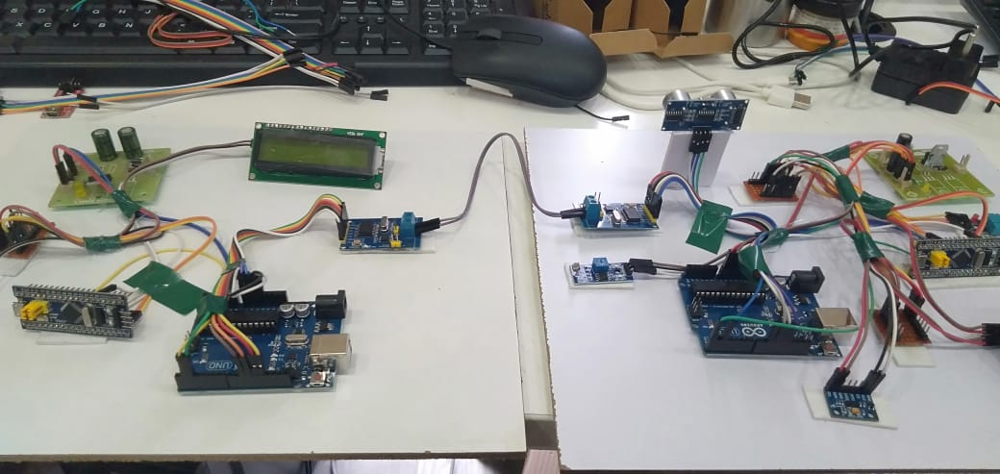
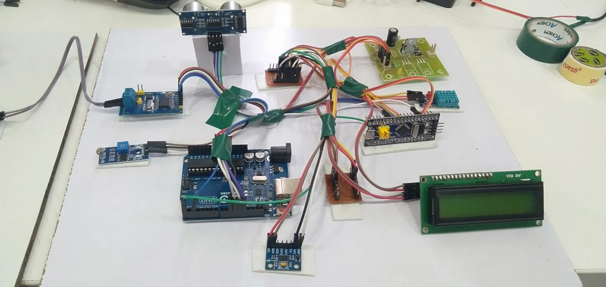
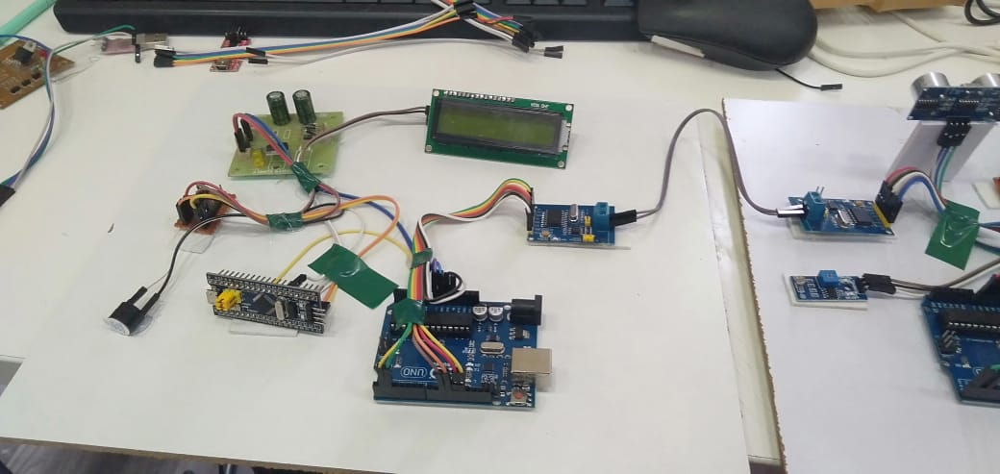

# CAN Bus Vehicle-to-Vehicle Alert System

A four-node prototype of vehicle-to-vehicle (V2V) hazard alerts. A sensor node on the "front vehicle" detects four hazards (obstacle ahead, crash, low light, high temperature) and sends an alert code over a **CAN bus at 500 kbps** to a second node, which shows the alert on an LCD and sounds a buzzer.

Built with two STM32F103C8T6 (Blue Pill) boards, two Arduino Unos and two MCP2515 CAN controller modules.



---

## System Architecture

```
  VEHICLE 1 (sensor side)                                  VEHICLE 2 (alert side)

 ┌──────────────────┐  UART   ┌──────────────┐  CAN bus  ┌──────────────┐  UART   ┌──────────────────┐
 │ STM32 Blue Pill  │ 9600 bd │ Arduino Uno  │ 500 kbps  │ Arduino Uno  │ 9600 bd │ STM32 Blue Pill  │
 │ sensor node      ├────────►│ + MCP2515    ╞═══════════╡ + MCP2515    ├────────►│ alert node       │
 │                  │ "2\r\n" │ UART→CAN     │ ID 0x100  │ CAN→UART     │  "2"    │                  │
 └──────────────────┘         └──────────────┘ CANH/CANL └──────────────┘         └──────────────────┘
   HC-SR04, ADXL345,                                                                16×2 LCD, buzzer
   DHT11, LDR, 16×2 LCD
```

1. **STM32 sensor node** reads all four sensors, cycles the readings on its LCD, and when a threshold is crossed sends a one-digit alert code over UART.
2. **Arduino CAN transmitter** receives the code, packs it into a CAN frame and sends it through its MCP2515.
3. **Arduino CAN receiver** reads frames from the bus and forwards the payload over UART.
4. **STM32 alert node** shows the matching message on its LCD and sounds the buzzer for 2 seconds. If no alert arrives for 3 seconds it shows "Everything is OK".

### Alert codes

| Code | Hazard | Trigger (sensor node) | Alert node shows |
|---|---|---|---|
| `1` | Vehicle ahead | HC-SR04 distance under 10 cm | Vehicle in front |
| `2` | Accident | ADXL345 X or Y acceleration over 0.5 g | Accident Alert |
| `3` | Low light | LDR reading over 600 | Low Light |
| `4` | High temperature | DHT11 temperature over 34 °C | Temp High |

### CAN frame

| Field | Value |
|---|---|
| Bit rate | 500 kbps |
| Identifier | `0x100` (standard 11-bit) |
| DLC | 1 |
| Data[0] | Alert code (1 to 4) |

---

## Hardware

| Component | Qty | Used for |
|---|---|---|
| STM32F103C8T6 "Blue Pill" | 2 | Sensor node and alert node |
| Arduino Uno | 2 | UART to CAN bridges |
| MCP2515 CAN module (8 MHz crystal, TJA1050 transceiver) | 2 | CAN controller and transceiver, SPI to the Uno |
| HC-SR04 ultrasonic sensor | 1 | Distance to the vehicle ahead |
| ADXL345 accelerometer (I2C) | 1 | Crash detection |
| DHT11 temperature and humidity module | 1 | Temperature monitoring |
| LDR light sensor module (analogue output) | 1 | Ambient light level |
| 16×2 LCD with I2C backpack (address `0x27`) | 2 | Local display on each STM32 node |
| Active buzzer | 1 | Audible alert on the alert node |
| Regulated power board (DC jack) | 2 | Power for each vehicle |





---

## Wiring

### STM32 sensor node

| Signal | Blue Pill pin | Connects to |
|---|---|---|
| Ultrasonic trigger | PB5 | HC-SR04 TRIG |
| Ultrasonic echo | PB3 (5 V tolerant) | HC-SR04 ECHO |
| DHT11 data | PB1 | DHT11 OUT |
| Light level | PA0 (ADC) | LDR module AO |
| I2C SCL | PB6 | ADXL345 SCL, LCD SCL |
| I2C SDA | PB7 | ADXL345 SDA, LCD SDA |
| UART TX | PA9 | Arduino Uno #1 D0 (RX) |
| Ground | GND | Common ground with the Uno |

### STM32 alert node

| Signal | Blue Pill pin | Connects to |
|---|---|---|
| Buzzer | PA1 | Active buzzer + |
| I2C SCL | PB6 | LCD SCL |
| I2C SDA | PB7 | LCD SDA |
| UART RX | PA10 | Arduino Uno #2 D1 (TX) |
| Ground | GND | Common ground with the Uno |

### Arduino Uno to MCP2515 (same on both Unos)

| MCP2515 | Uno |
|---|---|
| VCC | 5V |
| GND | GND |
| CS | D10 |
| SO | D12 (MISO) |
| SI | D11 (MOSI) |
| SCK | D13 |
| INT | Not used (the receiver polls) |

### CAN bus

CANH to CANH and CANL to CANL between the two MCP2515 modules, using a twisted pair. Both modules sit at the ends of the bus, so the 120 Ω termination jumper is fitted on each.

---

## Firmware

```
firmware/
├── stm32-sensor-node/    ← Reads sensors, drives LCD, sends alert codes over UART
├── arduino-can-tx/       ← UART to CAN bridge (MCP2515 transmitter)
├── arduino-can-rx/       ← CAN to UART bridge (MCP2515 receiver)
└── stm32-alert-node/     ← Shows alerts on LCD, drives buzzer
```

All four sketches use the Arduino framework. The Blue Pills run the STM32duino core.

### Libraries

| Library | Used by |
|---|---|
| [arduino-mcp2515](https://github.com/autowp/arduino-mcp2515) (autowp) | Both Unos |
| DHT sensor library (Adafruit) | Sensor node |
| LiquidCrystal_I2C (the version with `lcd.begin()` and no arguments) | Both STM32 nodes |

### Building and flashing

**Blue Pills**
1. In Arduino IDE, install the **STM32 MCU based boards** core (STM32duino).
2. Select **Generic STM32F1 series**, board part number **BluePill F103C8**.
3. Set **U(S)ART support** to enabled and **USB support** to none, so `Serial` is USART1 on PA9/PA10.
4. Upload with an ST-Link (upload method: STM32CubeProgrammer (SWD)) or a USB-to-serial adapter on PA9/PA10 using the BOOT0 jumper.

**Arduino Unos**
1. Install the libraries above, select **Arduino Uno**, and upload.
2. Disconnect the wire on D0/D1 while uploading. The Uno's USB uses the same UART.

---

## Design Notes

- **Separate sensing and CAN.** The CAN link runs on the Arduino and MCP2515 pair using the arduino-mcp2515 library, while the STM32 nodes only handle sensors, display and alerts over a UART. Each part could be tested on its own.
- **Why 500 kbps?** It's a standard automotive CAN rate (high-speed CAN, ISO 11898-2) and is well within the MCP2515's limits with an 8 MHz crystal.
- **Simple text protocol on UART.** Alert codes are sent as ASCII digits with a line ending, so every link can be checked with a serial monitor during debugging.

### Fixes made after the demo

The photos show the original build. Before publishing, I fixed these issues in the sensor node:

- **False "vehicle ahead" alerts.** When the HC-SR04 got no echo, `pulseIn()` returned 0, which was treated as 0 cm and triggered alert `1`. It now uses a 30 ms timeout and ignores readings with no echo.
- **Undefined evaluation order in the ADXL345 read.** `Wire.read() | (Wire.read() << 8)` doesn't guarantee which `read()` runs first in C++, so the high and low bytes could swap. The bytes are now read into a buffer first. Readings also start at zero, so a failed I2C read can't produce a false crash alert.
- **LCD text overflow.** Messages longer than 16 characters now fit on the display.

---

## Limitations and Next Steps

- **Blocking main loop.** The sensor node spends over 3 seconds per cycle in `delay()` while cycling its LCD screens, so an alert can take several seconds to go out. The next version will use a non-blocking `millis()` scheduler so sensing and alerting run independently of the display.
- **Native STM32 CAN.** The Blue Pill has a built-in CAN controller (bxCAN). Adding an SN65HVD230 transceiver to each Blue Pill and writing the CAN driver with STM32 HAL would remove the Arduino bridges and turn this into a two-node STM32 CAN network.
- **Richer CAN messages.** Send the raw sensor values (distance, acceleration, temperature) in separate frames with their own IDs, and use acceptance filters on the receiver.
- **Bus error handling.** Read and react to the MCP2515 error counters (TEC/REC) and bus-off state.

---

## Author

Devendra Reddy Keesara
MSc Embedded Systems & IC Design, Liverpool John Moores University
GitHub: [github.com/deva1611](https://github.com/deva1611)
